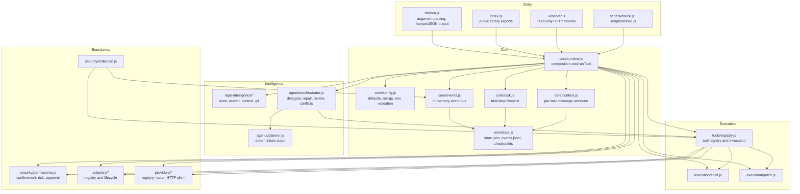

# Architecture

This document describes the implementation in this checkout. Every claim maps to a source file linked from the relevant section.

## Layered View



## Module Responsibilities

| Area | Module | Responsibility |
|---|---|---|
| Entry | [`bin/ora.js`](../bin/ora.js) | Parses flags with `parseArgs`; builds a runtime with `--cwd`, `--root`, `--state-dir`, and `--approval`; renders human or JSON output; installs a TTY approval prompt that returns `false` when `stdin.isTTY` is false |
| Entry | [`index.js`](../index.js) | Re-exports runtime, config, repo, agents, tools, execution, adapters, providers, and security functions |
| Entry | [`ui/server.js`](../ui/server.js) | Serves one HTML page and four GET endpoints; polls every 3 seconds; binds to `127.0.0.1` |
| Core | [`core/runtime.js`](../core/runtime.js) | Constructs and wires all services in `createRuntime`; implements `runTask`, `resumeTask`, and `status` |
| Core | [`core/config.js`](../core/config.js) | `DEFAULT_CONFIG`, deep merge of defaults, file, overrides, and `ORA_*` variables; validation; `publicConfig` |
| Core | [`core/task.js`](../core/task.js) | Creates tasks and steps, transitions status, stores artifacts, checkpoints, conflicts, and results |
| Core | [`core/context.js`](../core/context.js) | Maintains a per-task session with system message and up to 300 messages |
| Core | [`core/events.js`](../core/events.js) | Emits `{id,sequence,ts,type,level,message,data}` events, keeps up to 2000 in memory, supports `on`/`history` |
| Core | [`core/state.js`](../core/state.js) | Loads/saves `state.json`, appends `events.jsonl`, writes/reads checkpoints |
| Intelligence | [`repo-intelligence/scanner.js`](../repo-intelligence/scanner.js) | Walks the root with ignore rules, size and file caps, symlink checks, binary detection, caching, and a manifest; confines `readFile` to the root |
| Intelligence | [`repo-intelligence/detect.js`](../repo-intelligence/detect.js), [`context.js`](../repo-intelligence/context.js), [`search.js`](../repo-intelligence/search.js), [`git.js`](../repo-intelligence/git.js) | Detect project type, assemble context, literal text search, and git inspection |
| Planning | [`agents/planner.js`](../agents/planner.js) | `planSteps` turns goal, manifest, and spec into tool steps; `chooseVerification` picks a verification command; `extractActionsFromModel` parses model JSON |
| Agents | [`agents/orchestrator.js`](../agents/orchestrator.js), [`agents/registry.js`](../agents/registry.js) | Six specialist definitions; `plan`, `delegate`, `runParallel`, `review`, and `repair` |
| Execution | [`tools/registry.js`](../tools/registry.js) | Registers 15 built-in tools; authorizes, times out, redacts, truncates, and reports every invocation |
| Execution | [`execution/shell.js`](../execution/shell.js), [`execution/patch.js`](../execution/patch.js) | Shell process management; file writes, backup, unified diff parsing and application |
| Boundaries | [`security/permissions.js`](../security/permissions.js) | Root confinement, denied-path patterns, risk assessment, approval gate, destructive/network/metacharacter detection |
| Boundaries | [`security/redaction.js`](../security/redaction.js) | Replaces secret-shaped strings and secret-key values in strings and objects |
| Integration | [`adapters/registry.js`](../adapters/registry.js), [`adapters/lifecycle.js`](../adapters/lifecycle.js) | Adapter validation, discovery on `PATH`, subprocess execution, and in-memory lifecycle state |
| Integration | [`providers/registry.js`](../providers/registry.js), [`providers/router.js`](../providers/router.js), [`providers/openai-compatible.js`](../providers/openai-compatible.js) | Provider registration, health checks, completion calls, scoring, retries, and key scrubbing |

Composition happens in one place: `createRuntime` builds the event bus, state store, approval gate, permissions, repo intelligence, shell, patch engine, adapter and provider registries, task manager, context manager, tool registry, and agent system. Because agents and tools depend on each other, the tool registry receives the remaining services later through `tools.bind({ agents, adapters, approvalGate, providers, tasks, contexts })` ([`core/runtime.js`](../core/runtime.js)).

## Data Flow of `runtime.runTask`

Defined in [`core/runtime.js`](../core/runtime.js). The CLI `task run` and `task resume` commands both reach this function.

1. **Resolve the task.** With `taskId`, load the existing task; otherwise create one from `title`, `goal`, `root`, and `input: { spec }`. Require a non-empty goal.
2. **Prepare the run.** Record the prior approval mode, set it to `auto` only when `autoApprove` is true, and initialize a result object with `steps`, `verification`, `conflicts`, `checkpoints`, and `error`.
3. **Start and record context.** Call `tasks.start`, ensure a task session whose system message treats repository content as untrusted data, and add the goal as a `user` message.
4. **Scan.** `repo.scan()` produces a manifest; a `repo-manifest` artifact records its file count and languages.
5. **Plan.** `effectiveSpec = spec || task.input?.spec || {}`, then `agents.plan({ goal, manifest, spec, taskId, maxSteps })`. The plan is stored as a `plan` artifact. The default step sequence from `planSteps` is `repo.scan`, `repo.context`, spec-driven `fs.write`/`fs.patch`/`shell.exec` steps, optional delegation, `shell.exec` verification, and `git.diff` ([`agents/planner.js`](../agents/planner.js)).
6. **Execute each step.** Add and start a task step, emit `task:step:execute`, then call `tools.invoke` with the task id and configured timeout. On the first failed step (except `agent.delegate`), emit `task:repair`, call `agents.repair`, and invoke the same tool once more.
7. **Record the step.** Store `ok`, `denied`, `error`, output truncated to 2000 characters, and duration in the result; mark the task step completed or failed; append up to 3000 characters of output to the task context.
8. **Capture verification.** When the tool is `shell.exec` and the planned role is `tester`, set `result.verification` to `{ command, ok, exitCode, output }`. A failed tester shell step ends the loop early.
9. **Checkpoint.** Every `runtime.checkpointEvery` steps (default 3), write a checkpoint named `task:<taskId>:step:<stepIndex>` from `tasks.snapshot(task.id)` and append its id to the task and result.
10. **Finish.** Collect conflicts from the task snapshot, set `success` to "no failed steps", set status `completed` or `failed`, build the summary, review each `agent.delegate` result, persist the result with `tasks.complete`/`tasks.fail`, and emit `task:finished`. Any thrown error is captured with `errorRecord`, emits `task:error`, and marks the task failed.
11. **Restore.** Set `result.durationMs` before persistence in step 10, then restore the previous approval mode in `finally`. The returned result and the stored `task.result.durationMs` both contain the measured duration.

`resumeTask` calls `runTask` again with the same task id, goal, and stored spec. It does not continue from the last step; it re-plans and appends a fresh step sequence to the existing task.

## State and Checkpoint Design

[`core/state.js`](../core/state.js) owns a state directory resolved from `runtime.stateDir` (absolute paths are used as-is; relative paths resolve against `cwd`). Layout:

```text
<stateDir>/
  state.json                 # version, timestamps, counters, tasks, sessions, approvals
  events.jsonl               # one redacted JSON event per line
  checkpoints/<id>.json      # { id, name, ts, state }
  backups/                   # file contents saved before fs.write / fs.patch
```

- `save()` and `checkpoint()` use `atomicWrite`: write a `<path>.<uuid>.tmp` file, then `renameSync` it over the target.
- `state.json` has `version: 1`; a different version is merged into a fresh empty state with `version` reset to 1. There is no migration logic beyond that reset.
- Every event emitted by the bus is appended to `events.jsonl` through `events.on('*')`. `readEvents` tolerates an unparsable line by returning `{ type: 'corrupt', raw: '[unreadable]' }`.
- `checkpoint(name, data)` stores the supplied data. `runTask` passes a **task snapshot**, not the whole state tree. `listCheckpoints()` reads each file's metadata; unreadable files appear as `{ name: 'unreadable', ts: null }`.
- `restore(id)`, `removeCheckpoint(id)`, and `reset()` exist in the state store API but are not exposed by the CLI.

Task mutation always goes through `createTaskManager`: each change updates `updatedAt` and calls `state.save()` ([`core/task.js`](../core/task.js)). Context messages do the same ([`core/context.js`](../core/context.js)).

## Security Boundaries

Enforced in [`security/permissions.js`](../security/permissions.js), [`security/redaction.js`](../security/redaction.js), [`execution/shell.js`](../execution/shell.js), [`execution/patch.js`](../execution/patch.js), and [`repo-intelligence/scanner.js`](../repo-intelligence/scanner.js):

- **Roots.** The CLI builds permissions with `roots: [root, cwd]`; the library default root is `process.cwd()`. `confined(path)` resolves against the first root and accepts a path only if it equals or starts with an allowed root.
- **Denied paths.** Patterns from `security.deniedPaths` (for example `.env`, `*.pem`, `.ssh/**`, `.ora-state/**`) are checked against the path relative to an allowed root.
- **Tool authorization.** Before every tool handler, `invoke` calls `permissions.authorize` with the tool's `path`/`cwd`, `command`, `network`, and `external` flags. A denial returns `ok: false`, `denied: true`, and a redacted reason; the handler is not called.
- **Risk model.** Write tools are `medium`; `shell.exec` and `adapter.execute` are `high`. Destructive patterns (`rm -rf`, `git push`, `git reset --hard`, `git clean -f`, `chmod`/`chown`, `npm publish`, `docker ...`, and others) force `critical`. Network-capable commands and shell metacharacters (`|`, `>`, `&&`, `;`, `$(`, backtick) force approval.
- **Approval gate.** `auto` approves any risk that is not `critical` and denies `critical`; `deny` refuses everything; `manual` calls the configured prompt. The gate keeps pending and recent decisions in memory only.
- **Shell.** Commands are passed to `/bin/bash -c` with `shell: false`, a sanitized environment (a small base key set plus explicitly supplied variables), a 20,000-character and NUL-byte check, output caps, a timeout, and termination of the detached process group.
- **File writes.** The patch engine independently confines paths to its root and refuses symlinks in the path chain or at the target. Existing content is backed up under `<stateDir>/backups`, writes go through a temporary file and rename, and `fs.patch` supports `dryRun`.
- **Redaction.** The event bus redacts event data, tool output is redacted, provider errors and metadata scrub API keys, and secret-shaped environment values are replaced in strings and object values.

Repository content is treated as untrusted data in the task system message; model-assisted delegation puts repository context in a `user` message under that constraint ([`core/runtime.js`](../core/runtime.js), [`agents/orchestrator.js`](../agents/orchestrator.js)).

## Agent Execution Model

[`agents/registry.js`](../agents/registry.js) defines six roles with fixed tool allowlists: `architect` and `researcher` are read-only, as are `security` and `reviewer`; `coder` and `tester` can write or execute shell commands.

**Offline deterministic planning is the default.** `agents.useModel` defaults to `false`. `planSteps` uses goal tokens and spec fields to select steps; verification comes from `spec.verification` or `chooseVerification(manifest)`, which prefers package.json scripts (`test`, `check`, `verify`, `build`, `lint`) before ecosystem fallbacks ([`agents/planner.js`](../agents/planner.js)). Setting `ORA_USE_MODEL=1` (or `agents.useModel: true`) does **not** change `planSteps`; it enables model-generated actions only inside `delegate`.

For each delegation, `agents.delegate` ([`agents/orchestrator.js`](../agents/orchestrator.js)):

1. Builds up to 8000 characters of repository context with `repo.context`.
2. If model use is enabled and a provider registry exists, calls `providers.route` with a system instruction that requests `{"actions":[...]}` JSON, `maxAttempts: 2`, and at most 12,000 characters of context. Parsed actions are capped by `agents.maxActionsPerAgent` (default 12). A provider failure emits `agent:model_fallback` and yields no actions.
3. Falls back to `deterministicActions`: tester runs the chosen verification command; coder writes explicit spec edits (`fs.write` or `fs.patch`); analysis roles call `repo.context`.
4. Filters actions against the role's tool allowlist, invokes each through `tools.invoke` with `skipAuthorization: false`, and returns an `agent:end` event plus a result containing `actions`, `toolResults`, `filesTouched`, and a status of `completed` or `blocked`.

`runParallel` runs delegations with `concurrency` clamped to 1–8 (its own option, not `runtime.maxConcurrentAgents`), hashes touched files before and after, and records conflicts where two agents changed the same path with `resolution: 'review-required'`. `review` adds notes for blocked or conflicting results, excessive action counts, and possible credentials in serialized output. `repair` delegates to the `coder` role with an empty edit list.

## Adapter Lifecycle

[`adapters/registry.js`](../adapters/registry.js) registers five built-ins at runtime construction: `node`, `npm`, `git`, `opencode`, and `pi`. Additional definitions come from `config.adapters`. A definition requires `id`, `command`, and `capabilities`; optional fields include `args`, `versionArgs`, `envAllowlist`, `timeoutMs`, `enabled`, `kind`, and `description`.

[`adapters/lifecycle.js`](../adapters/lifecycle.js) provides `install`, `discover`, `validate`, `configure`, `enable`, `disable`, `execute`, `remove`, and `report`. Important implementation details:

- `install` registers an in-memory definition only; it does not download or install software.
- `discover` searches each command on `PATH` and sets `available` and `path`. Until discovery runs, `report()` shows `available: false` even for commands that exist.
- `validate` spawns `<command> <versionArgs>` (default `--version`) and caches the result; `configure`, `enable`, `disable`, `install`, and `remove` invalidate the cache.
- `execute` spawns without a shell, passes base environment keys plus `envAllowlist`, writes `input` to stdin, caps output at 200,000 characters, and escalates from SIGTERM to SIGKILL after 1 second on timeout.
- Lifecycle events are emitted as `adapter:<event>` through the runtime event bus.

## Provider Router

[`providers/registry.js`](../providers/registry.js) registers providers from `config.providers`, registers FreeLLMAPI by default, and registers OpenCode only when `integrations.opencode === true`. A spec requires `id` and an `http(s)` `baseURL`; without a custom `factory`, the OpenAI-compatible implementation is used ([`providers/openai-compatible.js`](../providers/openai-compatible.js)).

- `health()` calls `GET <baseURL>/models`; `complete()` calls `POST <baseURL>/chat/completions` with `{model, messages, max_tokens?, temperature?}`.
- HTTP 429 and 5xx responses retry up to three attempts with 250 ms exponential backoff; 401 is not retried. API keys are replaced with `[REDACTED]` in metadata and errors.
- [`providers/router.js`](../providers/router.js) scores candidates by explicit preference, context window, cost, speed, quality, and capability tags that match the task text. Health results are cached for 30 seconds. `route` tries up to `maxAttempts` ranked providers (the CLI `providers route` command uses 2; the router default is 3) and aggregates failures if all attempts fail.

The `model.complete` tool exposes routing to tasks and agents ([`tools/registry.js`](../tools/registry.js)), but the default deterministic planner does not call it.
